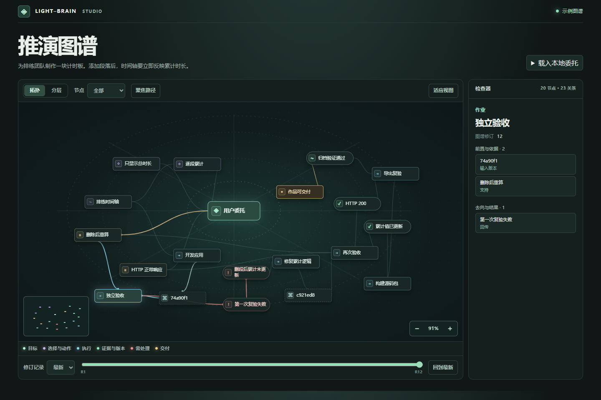
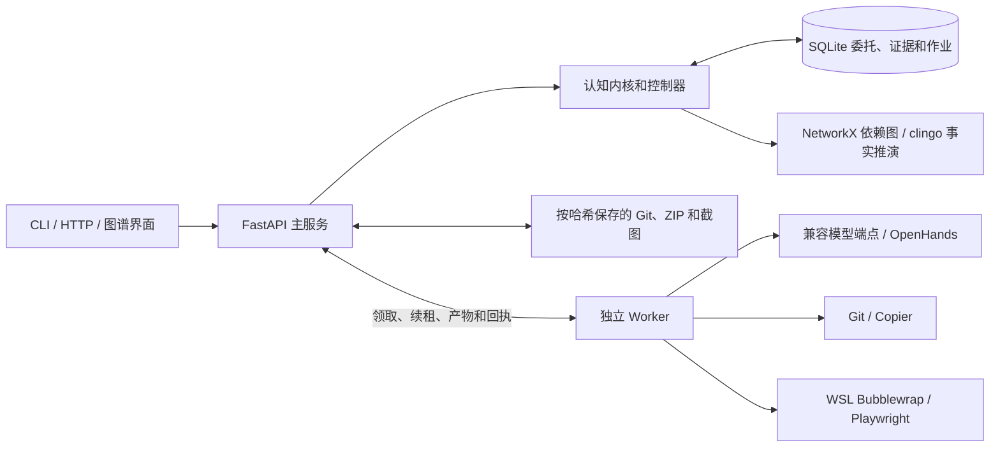

# Light-brain 光脑

Light-brain 是面向软件研发的持久 Agent。把一个想法或一份 Git 工程交给它，它会生成可执行的验收条件，在独立工作副本里实现方案，核对指定 Git 版本，再对最终源码包重新验收。每次派工、证据和交付物都可以从图谱追溯。



## 为什么要有光脑

- **让用户决定真实的产品取舍。** 当目标存在两种解释，光脑能找出能区分它们的观察。若差异来自产品偏好，就等待用户裁定。
- **让交付物可以独立复验。** 开发、候选验收和导出复验分别派工。结果绑定候选 Git 提交、验收条件摘要、运行环境和文件哈希。
- **让一个项目的经验进入下一个项目。** 项目可以沉淀可重放的行为检查。符合条件的 Python CLI 实现可以连同来源、摘要和适用范围一起复用。
- **让委托能续跑。** 委托、作业、回执和版本保存在正式库里。模型更换或进程重启之后，仍可从已登记的状态继续。

## 适用场景

| 场景 | 能交付什么 |
| --- | --- |
| 从一句话做本地 Web 应用 | 可操作的 HTML 试演、候选工程、浏览器验收、独立源码 ZIP |
| 开发 Python HTTP 服务 | 可独立启动的服务源码，带请求、响应和持久状态验证 |
| 新建命令行工具 | 源码、运行入口、正常输入与异常输入检查 |
| 接手已有 Git 项目 | 私有基线、依照原有行为开发、候选版本和变更证据 |
| 追查失败或评审代码 | 失败对应的候选版本与实际输出。只读评审可返回文件与行号 |
| 把经验用于另一工程 | 有授权和证据的检查重放，或受限的可移植源码复用 |

## 技术架构



模型提出解释与动作，控制器根据当前目标、前置条件、证据与授权挑选作业。运行中的计算图与持久图谱共享委托状态和作业证据。图谱提供拓扑、分层、上下游关系、路径聚焦、缩略导航和修订时间轴。示例明确展示一次失败如何触发修复与重新验收。[详细设计、文件结构与接口](docs/architecture.md)

## 安装与使用

当前验证平台是 Windows x64、Python 3.12、Git、uv、WSL2 Ubuntu x86_64，浏览器验收使用本机 Chromium、Chrome 或 Edge。先复制 `.env.example` 到本地 `.env`，填写兼容 Chat Completions 的服务地址、模型和密钥，再运行下列命令。

```powershell
.\启动光脑.ps1 -Setup
```

打开本机 [推演图谱](http://127.0.0.1:48717/studio) 可直接查看示例。查看自己的委托时，在界面输入本机令牌文件 `.lb/state/access.token` 的内容，默认实例为 `studio`。令牌只留在当前网页内存。工作台集成通过服务端读取令牌。

在第二个 PowerShell 窗口提交委托，取得返回的 `id` 后，以它替换下面的 `<case-id>`。首次执行可以用一个自包含的简单应用。

```powershell
$py = '.\.lb\env\Scripts\python.exe'
& $py -B lb.py submit '制作一个排练计时网页，用户可以新增和移除段落，并看到实际累计时长。' --brain studio
& $py -B lb.py show '<case-id>'
& $py -B lb.py graph '<case-id>'
& $py -B lb.py wait '<case-id>'
& $py -B lb.py download '<case-id>' '.\rehearsal.zip'
& $py -B lb.py revise '<case-id>' '保留原有流程，加入清空当前排练的操作。'
```

可选的 `-EnableOpenHands` 安装固定版本的工具型执行器，提交时加 `--executor openhands`。已有兼容模型配置文件可用 `-ModelProfile` 指定。真实模型运行需要能够访问配置的模型服务。HTTP 动态预览使用通过 HTTP 验收的工程启动独立本机进程。版本登记和回滚走本地模拟发布渠道。

### 工作台集成

孵化器的服务端为每个 Web 项目关联一个 LB 委托，浏览器通过工作台查看图谱、发起修订、打开预览和下载已验收源码包。接入方可以按各自的产品权限实现这一层。

[集成接口及版本语义](docs/architecture.md#工作台接入) · [手机图谱截图](docs/images/graph-mobile.png)
